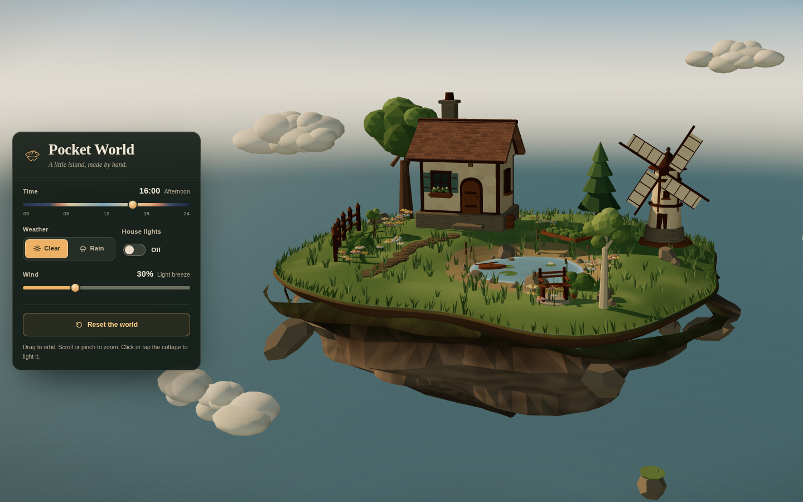

# Pocket World

A small floating island diorama built with Three.js, TypeScript, and Vite. A cream cottage, a working windmill, a pond with a rowboat, a garden, and a cluster of trees sit on a grassy rock above a wide sky. Time, weather, wind, and cottage lights all drive one shared scene state.



## Run it

Requires Node.js 20 or newer.

```bash
npm install
npm run dev
# open http://127.0.0.1:5173
```

Build and check:

```bash
npm run typecheck
npm run build
npm run preview
# open the URL Vite prints, usually http://127.0.0.1:4173
```

There is no backend, API key, or network asset at runtime.

## Controls

- **Time**: a full 24 hour slider. It moves the sun and moon, changes sky and light colors, exposure, stars, and the prominence of the cottage windows.
- **Weather**: Clear or Rain. Rain fades in with a darker sky, darker clouds, softened light, world-space rain, and pooled ripples on the pond.
- **Wind**: drives windmill rotation, tree sway, cloud drift, chimney smoke, and rain slant. At zero wind the wind-driven motion stops; rain still falls.
- **House lights**: use the switch or click/tap the cottage. Both paths read and write the same state.
- **Reset the world**: restores 16:00, clear weather, 30% wind, lights off, and the opening camera.
- **Camera**: drag to orbit, scroll or pinch to zoom. Panning is disabled, distances and vertical angles are limited, and damping smooths the movement.
- On small screens the panel becomes a bottom sheet and starts collapsed behind the visible **Controls** button. The camera reframes above it. Escape closes the sheet.

All controls are native buttons, sliders, and a switch with visible focus rings. The operating system reduced-motion preference skips the intro camera move and damps decorative motion while leaving functional motion such as the windmill and rain in place.

## Design notes

Reading: an interactive diorama for curious visitors, in a handmade storybook-miniature visual language, dial ENERGY 2 / RHYTHM 2 / MOTION 2.

- The palette comes from the brief: soft grass, warm timber, cream plaster, muted teal water, and amber light. The pine and cream panel uses the same family so the interface belongs to the island.
- The wordmark is a warm serif, suggesting a storybook plate; the labels use a quiet humanist sans so small controls stay legible.
- Amber is reserved for active controls, the time knob, and the cottage windows. That is the one deliberate accent.
- The little island glyph is the identity mark and repeats in loading and error states.
- The panel is a solid instrument card rather than glass, keeping the world as the focal surface. The day-cycle gradient on the time track encodes real data.
- Every mesh, texture, cloud, star, rain streak, smoke puff, and ripple is generated in code. No models, image textures, HDRIs, icon packs, font files, or asset packs are downloaded.

## Structure

```text
src/
  app.ts                 renderer, world assembly, loop, picking, layout
  state.ts               one shared state store
  environment/           time keyframes, runtime smoothing, sky, lights, stars
  world/                 terrain, island, house, trees, windmill, pond, props, clouds
  effects/               rain lines and the fixed ripple pool
  interaction/camera.ts  OrbitControls setup, responsive fit, reset tween
  ui/panel.ts            panel bindings and synchronized controls
  utils/                 procedural textures, geometry helpers, math
```

Time, weather, wind, and lights are smoothed into a single frame state. All scene effects read from that frame. The animation loop clamps large deltas after a background tab, transitions are interruptible, and rain and ripple objects are pooled. Small screens use a lower pixel ratio cap, smaller shadow maps, and fewer rain and grass instances.

## Verification

Checks run in this workspace:

- `npm run typecheck` passes.
- `npm run build` passes. Vite reports a chunk larger than 500 kB from Three.js; this is expected for a single-scene 3D bundle.
- The production build was served with `npm run preview` and loaded with no console errors.
- Browser checks at 1440x900, 844x390, and 390x844:
  - initial framing and resize
  - orbit, zoom, and reset camera
  - day, sunset, and night states
  - rain on and off repeatedly: the rain mesh hides, the amount returns to zero, and the ripple pool empties with a constant scene object count
  - wind at 0% and 100%: windmill, tree crowns, clouds, and rain slant follow the shared value
  - cottage click toggles the lights and updates the switch; dragging across the cottage orbits without toggling
  - every panel control works with mouse and keyboard, with visible focus
  - mobile collapsed and expanded sheets, 44 px touch targets, and no horizontal overflow
  - reduced-motion emulation, with no camera intro tween
  - WebGL disabled, showing the readable error card and reload action
- A one-off headless Chrome sample at 1440x900 measured about 58 fps, 322 draw calls, 48,912 triangles, and 11 textures. This is a local observation, not a benchmark for every device.

More views: [rainy night with lights](screenshots/rain-night-lights.png), [mobile](screenshots/mobile-default.png), [mobile controls](screenshots/mobile-controls.png).

## Known limits

- Water, rain, clouds, and smoke are stylized approximations, not simulations. There is no real-time reflection, refraction, or fluid physics.
- State is in memory only. Reloading returns to the default afternoon.
- WebGL is required. The error card explains the failure when it is unavailable.
- Controls start collapsed on small screens by design. The visible Controls button opens them.
- There is no audio.
