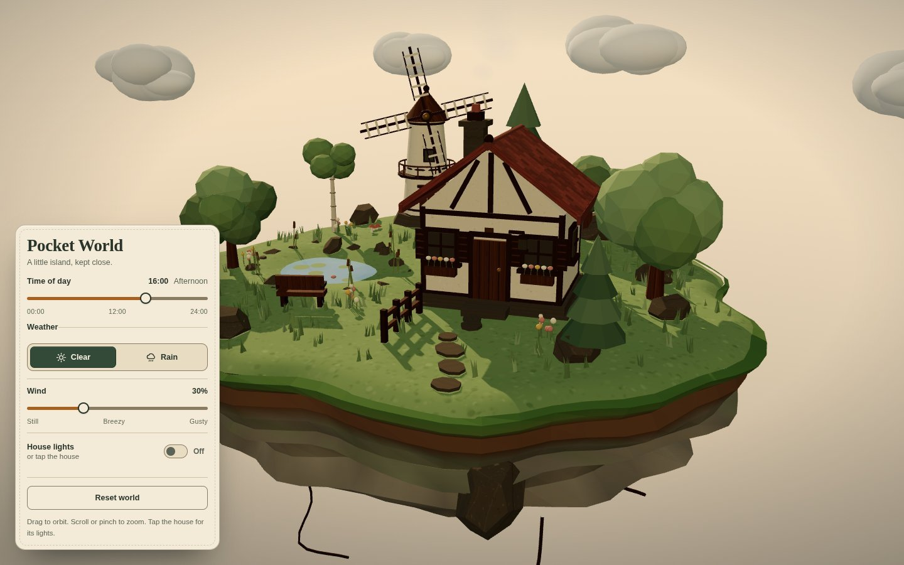
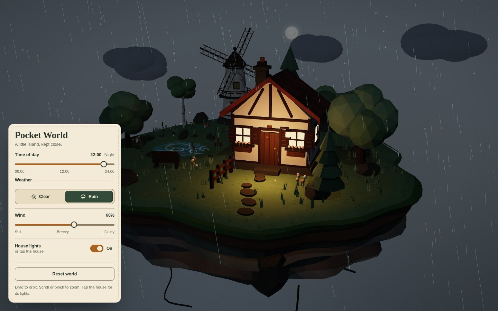

# Pocket World

An interactive floating-island diorama built with Three.js, TypeScript and Vite. Everything in the scene is generated in the browser: sculpted terrain, a timber-framed cottage with warm windows, a working windmill, a pond, varied trees, clouds and procedural textures. There are no downloaded models, image textures, HDR environments or runtime services.





The screenshots above are from the implemented app, not mockups. A portrait mobile capture is in `docs/preview-mobile.jpg`.

## Requirements

- Node.js 20.19 or newer (Node 24 was used for development).
- A browser with WebGL2.

## Install and run

```bash
npm install
npm run dev
```

Open the URL printed by Vite, normally `http://127.0.0.1:5173/`.

## Production build

```bash
npm run build
npm run preview
```

`npm run build` runs the TypeScript check and writes the production bundle to `dist/`. `npm run preview` serves the built output, normally at `http://127.0.0.1:4173/`.

Other useful commands:

```bash
npm run typecheck
```

## What you can do

- **Orbit and zoom:** drag to orbit, scroll to zoom, pinch to zoom on touch. Panning is disabled so the island cannot be lost.
- **Time of day:** a 24-hour slider with a readable clock and period. The sky, sun, fog, exposure, stars, moon and window glow all change continuously.
- **Weather:** Clear and Rain. Rain fades in and out, darkens the clouds, softens the light and adds pooled ripples to the pond.
- **Wind:** one shared 0 to 100 percent control. It changes windmill speed, canopy sway, cloud drift and rain angle. At zero wind the wind-driven motion stops and rain still falls vertically.
- **House lights:** click or tap the cottage, or use the House lights switch. Both paths update the same state. A drag across the house does not toggle the lights.
- **Reset world:** restores the opening camera, 16:00, Clear weather, 30 percent wind and the house lights off.

### Keyboard

- Tab moves through the controls and the canvas.
- Sliders respond to the arrow keys. Buttons respond to Enter or Space.
- With the 3D canvas focused, arrow keys orbit and `+` / `-` zoom.
- Every focusable control has a visible focus indicator.

## Project shape

```text
src/
  main.ts                 bootstrap, WebGL failure handling, render loop
  state.ts                shared world store and formatting helpers
  style.css               responsive paper-tag interface
  lib/
    geometry.ts           irregular surfaces and ground ribbons
    noise.ts              seeded random, value noise and damping helpers
    textures.ts           procedural canvas textures
  scene/
    world.ts              assembles the complete island
    island.ts             sculpted body, meadow, tufts and roots
    house.ts              cottage, glazing, chimney and point light
    pond.ts               shoreline, reeds, lily pads and water shader
    windmill.ts           tower and wind-driven rotor
    trees.ts              four tree silhouettes with canopy sway
    clouds.ts             drifting cloud layer
    details.ts            path, fence, bench, rocks, flowers and mushrooms
    ambient.ts            chimney smoke and nighttime fireflies
    palette.ts            shared scene palette and materials
  environment/
    environment.ts        time, weather, lighting and sky transitions
    timeOfDay.ts          24-hour palette and sun position
    sky.ts                gradient sky, stars and moon
    rain.ts               pooled 3D rain streaks
    ripples.ts            pooled pond ripples
  interaction/
    cameraRig.ts          OrbitControls, framing, limits and keyboard orbit
    housePicker.ts        click versus drag picking
  ui/
    panel.ts              binds all controls to the shared store
```

## Implementation notes

- The render loop uses a capped delta of 50 ms and time-based updates, so returning from a background tab does not jump the simulation.
- Environmental changes ease toward targets. Rapid slider changes only change the target; there are no competing animation timelines.
- Rain drops and pond ripples are fixed pools. Repeated weather changes do not create new objects.
- Desktop uses a 2048 shadow map and up to 2x pixel ratio. Mobile and constrained devices use a 1024 shadow map, a lower pixel ratio and roughly half the rain streaks.
- `prefers-reduced-motion` is respected in both CSS and the 3D scene.
- If WebGL cannot initialize, or the context is lost, the page shows a readable error card with a reload button instead of a blank canvas.

## Verification performed

- `npm run typecheck` and `npm run build` both pass.
- Checked in Chrome through the dev server at 1440x900, and in emulated 390x844 portrait and 844x390 landscape viewports.
- Inspected default daylight, sunset, clear night with house lights on, and rainy night with house lights on.
- Exercised Clear and Rain repeatedly and confirmed the rain mesh count, ripple pool size and visibility stay stable.
- Verified wind at 0 percent and 100 percent: rotor speed, clouds, canopy sway and rain tilt all respond, while rain still falls at zero wind.
- Verified the click/tap versus drag distinction on the house, and confirmed the 3D interaction and the UI switch stay synchronized.
- Verified keyboard changes on both sliders, keyboard camera orbit and reset of every control and of the camera.
- Verified reduced-motion behavior through browser emulation: smoke hidden, canopy sway reduced, functional motion preserved.
- Verified the browser console is clean during normal operation after a fresh load.
- Measured the scene at about 50k triangles and roughly 800 draw calls including shadows. The test machine held above 60 fps at both the desktop and emulated mobile sizes, including rain.

## Limitations

- Rain and pond ripples are lightweight procedural approximations, not a fluid simulation.
- The moon is a fixed decorative sky element, not an astronomical simulation.
- There is no audio, persistence or backend.
- Automated testing used synthetic pointer events for touch. Real hardware pinch gestures were not available in this environment, though the standard OrbitControls touch path is enabled and was exercised through emulated touch events.
