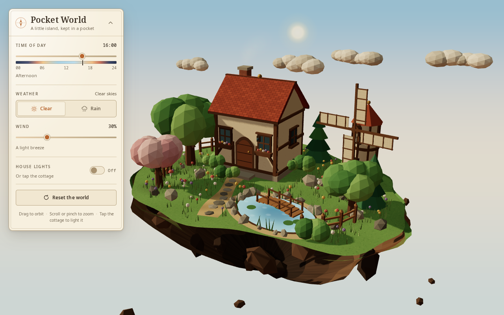
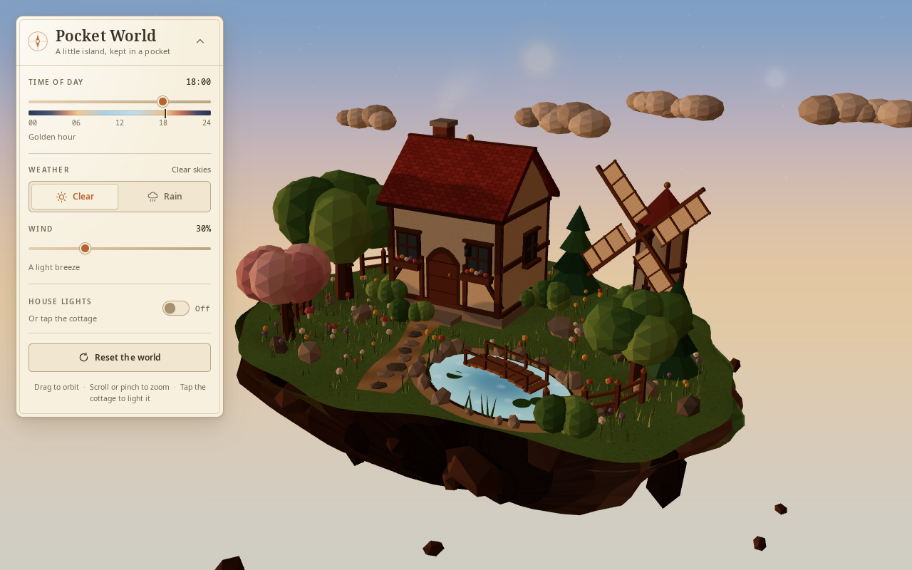
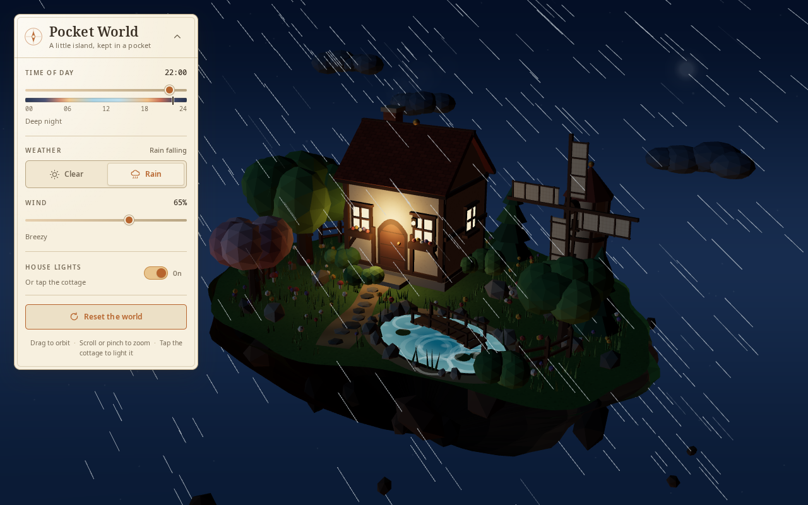
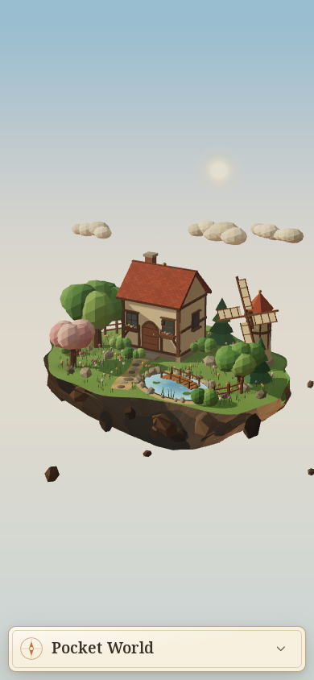

# Pocket World

A small floating island, built entirely from code. Orbit it, move the sun
through a full day, bring in the rain, turn up the wind and tap the cottage to
light its windows. Runs in the browser with **Three.js + Vite + TypeScript**;
no backend, no downloaded models, textures, HDRIs or remote assets.



| Golden hour | Rainy night, lights on | Mobile |
| --- | --- | --- |
|  |  |  |

## Run it

Requires Node.js 20 or newer and a WebGL-capable browser.

```bash
npm install          # install dependencies
npm run dev          # dev server, hot reload (usually http://localhost:5173)
npm run build        # tsc --noEmit && vite build  ->  dist/
npm run preview      # serve the production build (http://localhost:4173)
npm run typecheck    # type check only
npm run verify       # headless Chromium: 36 behavioural checks + screenshots
```

`vite.config.ts` uses a relative `base: './'`, so `dist/` works from any
sub-path, including the arena route `/hy-4-workbuddy/`.

## Controls

| Control | Action |
| --- | --- |
| Drag / one-finger drag | Orbit, with damping and clamped angle and distance |
| Scroll / pinch | Zoom within safe limits; panning is disabled |
| Time of day | 00:00 to 24:00, quarter-hour steps, with a day/night ribbon |
| Clear / Rain | Weather, eased in and out |
| Wind | 0 to 100%, one shared state for sails, trees, clouds and rain slant |
| House lights | Toggle by switch, by keyboard, or by tapping the cottage |
| Reset the world | Returns camera, 16:00, clear, 30% wind and lights off |
| Panel chevron | Collapse or expand the card; collapsed by default on small screens |

Everything is keyboard reachable, with a visible focus ring. With
`prefers-reduced-motion: reduce`, decorative bobbing, sway and chimney smoke
are reduced while all controls stay functional.

## What is in the island

A faceted, tapered cliff with a grassy irregular rim; a half-timbered cottage
with shingled gable roof, chimney, flower boxes and emissive windows; a
windmill with battened cloth sails; a pond with a custom water shader, sandy
shore, stones, reeds, lily pads, a footbridge and pooled ripple rings; oaks,
pines, a blossom tree, bushes, mushrooms, fences, a curving sandy path and
instanced grass and flowers; faceted clouds, a sun and moon disc, stars and a
few rocks suspended below the island.

All textures (shingles, plaster, bricks, grass speckle, sail cloth, contact
shadows, smoke puffs) are drawn on a canvas at runtime.

## How it is put together

```
src/
  main.ts                 renderer, camera, framing, render loop, debug handle
  state.ts                one AppState + eased SmoothState, time/period labels
  util/math.ts            clamp, lerp, smoothstep, damp, seeded PRNG
  world/
    palette.ts            palette and the continuous 24-hour sky curve
    materials.ts          shared materials + one wetness registry for rain
    textures.ts           procedural canvas textures
    island.ts             coastline, grass top, faceted stratified cliff
    house.ts              cottage, windows, chimney smoke, interior lamp
    windmill.ts           tower and four rotating sails
    pond.ts               water shader, shore, bridge, pooled ripples
    vegetation.ts         trees and wind-driven crown sway
    props.ts              path, fences, instanced grass/flowers, rocks
    clouds.ts             wind-driven, weather-aware cloud banks
  environment/
    sky.ts                screen-graded sky dome, sun/moon, stars, fog
    lighting.ts           sun, hemisphere, cool fill, warm ground bounce
    rain.ts               pooled 3D rain streaks with landing and recycling
  interaction/picker.ts   tap-vs-orbit-drag detection on the cottage
  ui/panel.ts             DOM controls bound to the shared state
  style.css               field-notebook control card, responsive layout
verify.mjs                headless Chromium behavioural verification
```

Time, weather, wind and house lighting live in one `WorldState`. Every scene
effect is derived from its eased values, so rapid changes cannot leave
competing animations behind. Rain and ripples are pooled, frame deltas are
clamped, and the sun's shadow map is only re-rendered when the sun or weather
actually changes.

## Verification actually performed

`npm run verify` serves `dist/` on `127.0.0.1:4199`, opens it in headless
Chromium (SwiftShader WebGL), and reports **36/36 PASS, 0 console errors or
failed requests**. It checks the initial framing (real projected vertices,
including the underside), noon/sunset/night sky and light differences, eased
rather than stepped time changes, rain appearing and clearing repeatedly with
no particle accumulation, cloud and ripple response, zero wind stopping both
sails and clouds, rain slant, the cottage tap versus an orbit drag, the UI
switch staying in sync, keyboard operation and focus rings, rapid control
changes, reset restoring the camera and every control, mobile and short
landscape layouts, reduced motion, and a readable fallback when WebGL is
unavailable. It writes `shots/01` through `shots/07`, including the default,
golden hour, rainy night with lights on, mobile, expanded mobile panel,
post-reset and short-landscape views. All of those screenshots were inspected
visually.

## Limitations

- Requires WebGL. Without it a readable message is shown instead of a blank page.
- Software WebGL (headless SwiftShader, very old integrated GPUs) renders far
  fewer frames per second than a normal GPU; the scene stays correct but motion
  is less smooth.
- The sky is a graded backdrop rather than a physically positioned atmosphere:
  because the camera always looks slightly down at a miniature, an astronomical
  sky dome would show only one band of colour.
- No physics engine, no sound, no saved state. Reloading returns to 16:00.
