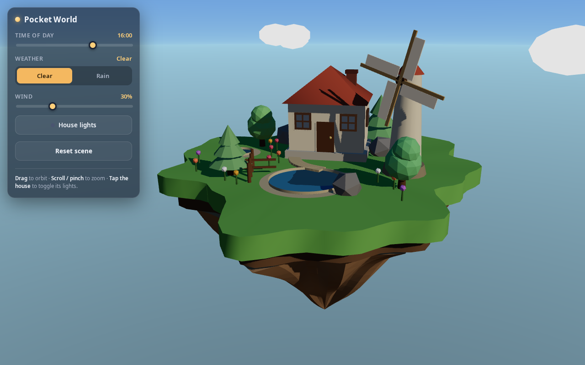
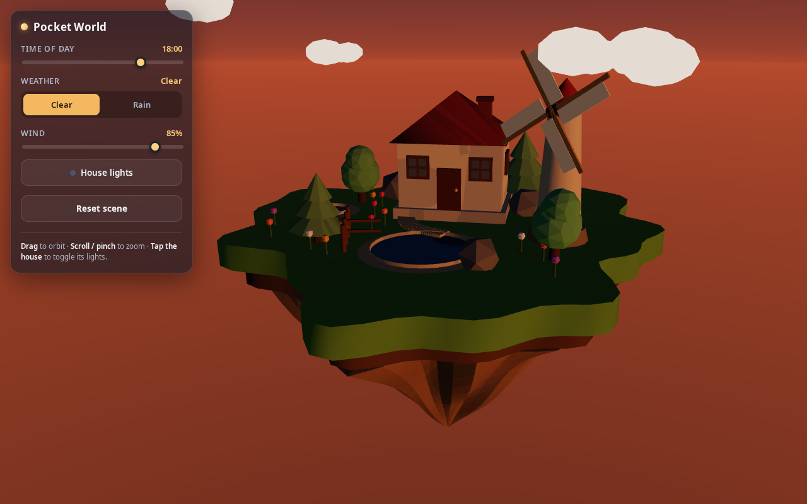
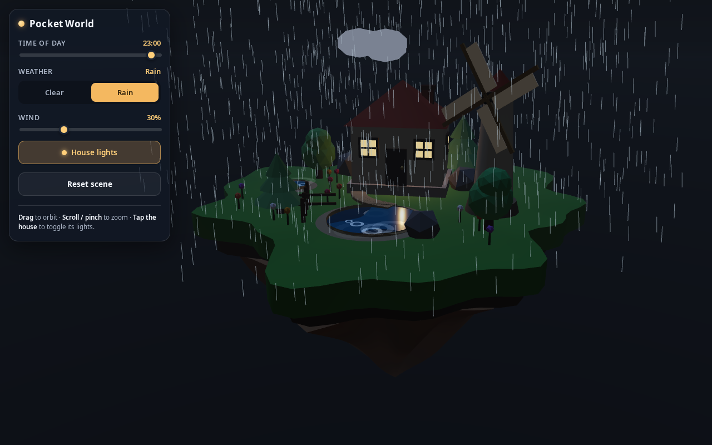
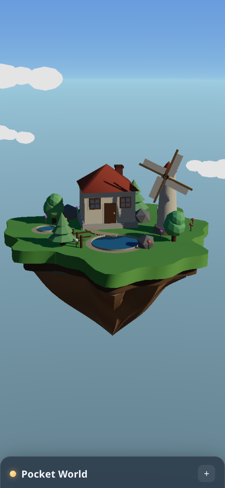

# Pocket World

A polished, interactive 3D diorama of a tiny floating island — a little handmade
miniature that you can orbit, re-time, and re-weather. Built with **Three.js**,
**Vite**, and **TypeScript**. Runs entirely in the browser; no backend, no
external assets, everything procedural.



| Golden hour | Rainy night | Mobile |
| --- | --- | --- |
|  |  |  |

## Features

- **Floating island** with a grassy top, irregular silhouette, and a sculpted
  rocky underside.
- **House** with pyramid roof, door, framed windows, and a chimney. Click it to
  switch on the warm amber interior light.
- **Pond** with a raised shoreline and surface ripples that respond to rain.
- **Varied trees** (pine + round canopies), a **windmill** with rotating sails,
  **clouds**, rocks, a path, a fence, and scattered flowers.
- **Time of day** slider (00:00–24:00) driving sun direction, light colour and
  sky gradient — a bright day, a warm golden hour around 18:00, and a readable
  blue night with stars and a moon, all cross-faded smoothly.
- **Clear / Rain** weather with 3D rain particles, darker clouds, softened
  sunlight, and pond ripples (no screen-space overlay).
- **Wind** slider that drives the windmill, tree sway, cloud drift, and rain
  slant from one shared state.
- **House-light toggle** via 3D click (distinguished from an orbit drag) *and*
  a synced UI button.
- **Reset** to the composed default view (16:00, clear, 30% wind, lights off).
- **Responsive** UI (collapsible panel on mobile), reduced-motion support,
  WebGL capability guard, clamped frame deltas, and pooled particles.

## Requirements

- **Node.js 20+** (developed on Node 24; Vite 8 requires a modern runtime).
- A browser with **WebGL** support.

## Installation

```bash
npm install
```

## Development

Start the dev server with hot reload:

```bash
npm run dev
```

Then open the printed local URL (typically <http://localhost:5173>).

## Production build

Type-check and build a static bundle into `dist/`:

```bash
npm run build
```

The output is a self-contained static site (relative asset paths, so it can be
served from any sub-path). Deploy the contents of `dist/` to any static host.

## Preview the production build

```bash
npm run preview
```

Serves the built `dist/` on <http://localhost:4173> (use `--host` to expose it
on your network).

## Controls

| Control | Action |
| --- | --- |
| Drag / one-finger drag | Orbit the camera |
| Scroll / pinch | Zoom (clamped) |
| Time slider | Set time of day (00:00–24:00) |
| Clear / Rain | Toggle weather |
| Wind slider | Set wind strength (0–100%) |
| Click the house | Toggle its interior lights |
| House-lights button | Toggle lights from the UI |
| Reset | Restore defaults |

Add `?debug` to the URL (e.g. `?debug`) to expose a `window.__pocketWorld`
handle for automated inspection.

## Project layout

```
src/
  config.ts              # tunables, capability flags
  state.ts               # AppState (time, weather, wind, houseLights)
  util/math.ts           # clamp / lerp / damp / smoothstep helpers
  world/                 # island, house, trees, windmill, water, clouds, props
  environment/           # sky + lighting (sky.ts), rain (rain.ts)
  interaction/picker.ts  # tap-vs-drag detection for the house
  ui/panel.ts            # control panel + sync
  main.ts                # scene assembly, loop, resize, debug hook
verify.mjs               # headless behavioural verification (Puppeteer)
```

## Verification

`verify.mjs` launches the production preview in headless Chromium (SwiftShader)
and runs 19 checks, then writes screenshots to `shots/` for visual review:

- scene initialises with no error overlay
- the house projects to a known screen point
- dragging across the house does **not** toggle its lights; clicking it does
- the UI light toggle stays in sync with the 3D interaction, both ways
- orbit drag moves the camera
- Reset restores time / weather / wind / lights **and** the UI controls
- rapid changes to time, weather and wind keep the scene alive
- repeated rain toggles stay stable (no particle accumulation)
- the sky and lighting measurably differ between noon, night and dusk
- `prefers-reduced-motion` still renders a live scene
- with WebGL disabled, a readable fallback message is shown instead of a blank page

```bash
npm run build
npm run preview &        # serves on :4173
node verify.mjs          # 19/19 checks, 0 console errors
```

## Notes & limitations

- Screenshots are written to `shots/` by the verification harness for visual QA.
- Visual quality depends on the GPU; on low-end/headless devices pixel ratio and
  particle counts are reduced automatically.
- Requires a WebGL-capable browser; otherwise a readable fallback message is
  shown instead of a blank page.
- The camera looks down at the island, so the moon and stars sit above the
  default framing — orbit below the island to bring them into view.
- The `dist/` bundle is ~600 kB (150 kB gzipped), most of it Three.js. No
  code-splitting is applied since the whole scene is needed on first paint.
