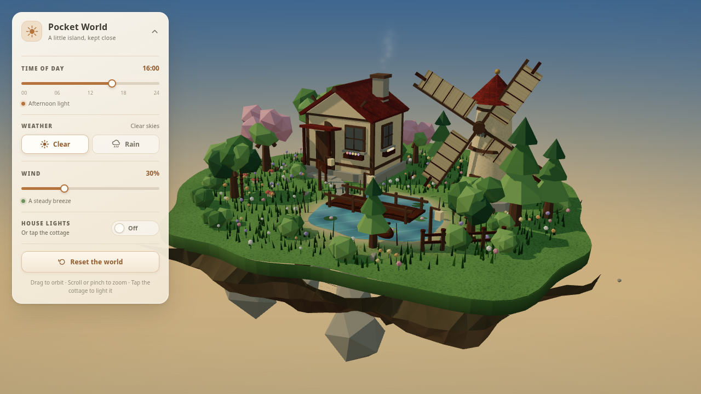
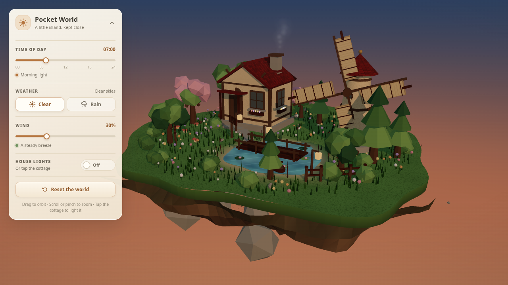
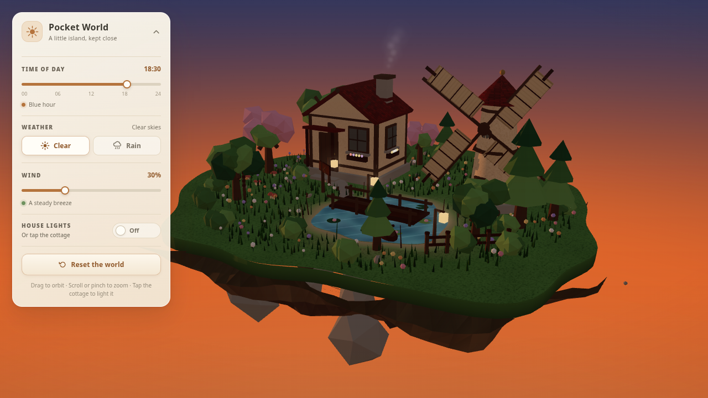
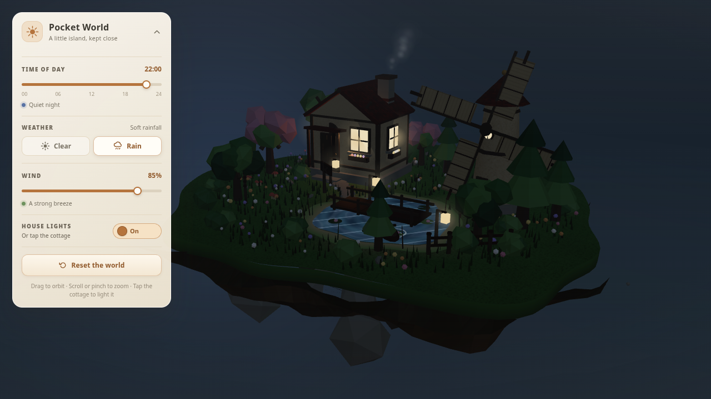

# Pocket World — `hy4-flash-workbuddy`

A tiny floating island you can hold in the palm of your hand: orbit it, move the
sun through a full day, call in the rain, turn up the wind and tap the cottage
to light its windows. Built entirely in code with **Three.js + Vite +
TypeScript** — no downloaded models, image textures, HDRIs, remote assets,
backend or API keys.



| Morning | Golden hour | Rainy night, lights on |
| --- | --- | --- |
|  |  |  |

## Run it

Requires Node.js 20.19+ (or 22.12+) and a WebGL-capable browser.

```bash
cd /home/programmer/Projects/ai-arena/hy4-flash-workbuddy
npm install          # install dependencies
npm run dev          # dev server with hot reload, http://localhost:5173
npm run build        # tsc --noEmit && vite build  ->  dist/
npm run preview      # serve the production build, http://localhost:4173
npm run typecheck    # type check only
npm run verify       # headless Chromium checks + screenshots in shots/
```

`vite.config.ts` uses a relative `base: './'`, so `dist/` also works when
hosted from a sub-path. If headless verification cannot find Chromium, set
`CHROME_PATH=/path/to/chrome npm run verify`.

## Controls

| Action | What it does |
| --- | --- |
| Drag / one-finger drag | Orbit with damping; polar angle and distance are clamped, panning is disabled |
| Scroll / pinch | Zoom between safe limits |
| Time of day slider | Continuous 00:00–24:00 sun, sky, fog, exposure and night lighting |
| Clear / Rain | Eased weather change: 3D rain, darker clouds, wetter materials, pond ripples |
| Wind slider | One shared value drives sails, tree sway, cloud drift and rain slant |
| House lights switch | Emissive windows, interior lamp and a soft glow |
| Click / tap the cottage | Same light state as the switch; a drag never toggles it |
| Reset the world | Camera, 16:00, clear skies, 30% wind, lights off |
| Panel chevron | Collapse or expand the card (starts collapsed on phones) |

Every control is keyboard reachable with a visible focus ring. With
`prefers-reduced-motion: reduce`, decorative bob, sway, smoke and ripple
spawning are suppressed while functional controls keep working.

## What is in the world

A faceted, stratified cliff with an irregular grassy rim; a half-timbered
cottage with shingled gable roof, porch, flower boxes, chimney and smoking
flue; a stone windmill with four battened sails; a pond with a procedural
water shader, sandy shore, lily pads, reeds, a footbridge and a little rowing
boat; oaks, pines and a blossom tree; bushes, mushrooms, instanced grass and
wildflowers; a curving stepping-stone path, fences, lanterns, a signpost and a
woodpile; drifting low-poly clouds, sun, moon, shader stars and suspended
rocks. All textures (shingles, plaster, wood, grass, sail cloth, glow) are
painted on a canvas at runtime.

## Code layout

```
src/
  main.ts                 renderer, camera framing, loop, reset tween, debug handle
  state.ts                single Store + eased SmoothedState
  util/                   math helpers, seeded RNG, static mesh merging
  world/
    palette.ts            24-hour sky/lighting keyframes
    materials.ts          shared materials and rain wetness registry
    textures.ts           procedural canvas textures
    island.ts             coastline, grass top, faceted cliff, floating stones
    house.ts              cottage, windows, lamp, chimney smoke
    windmill.ts           tower and rotating sails
    pond.ts               water shader, shore, props, pooled ripples
    vegetation.ts         trees, sway, instanced grass and flowers
    props.ts              path, fences, lanterns, rocks, signpost
    clouds.ts             wind-driven, weather-aware cloud banks
  environment/
    sky.ts                gradient dome, shader stars, sun, moon, fog
    lighting.ts           sun, moon, hemisphere and ambient light
    weather.ts            pooled, recycled 3D rain streaks
  interaction/picker.ts   click-versus-drag house picking
  ui/panel.ts             control bindings and accessible state
```

Static meshes are merged per material (animated parts opt out), grass and
flowers are instanced, rain and ripples are pooled, and pixel ratio, shadow
map size and particle counts are reduced on small or low-core devices.

## Verification actually performed

`npm run build` passes with no type errors. `npm run verify` ran headless
Chromium against the production build and passed **18/18 checks**, covering:
initial state and rendering, morning/golden-hour/night changes, rain and wind
easing, repeated rain on/off without stale effects, house click versus camera
drag, UI/3D light synchronization, full reset of state and camera, rapid input
changes, mobile panel behaviour, resize framing and a clean browser console.

The screenshots in `shots/` were captured during that run and inspected:
default, morning, golden hour, rainy night with lights, after reset, mobile
collapsed/expanded and short landscape.

## Limitations

Rain is a lightweight procedural approximation (recycled streaks and ripple
rings), not a fluid simulation. Very old or software-rendered WebGL devices
will run slower, though quality is automatically reduced. There is no
physics engine, persistence, account system or network dependency.
